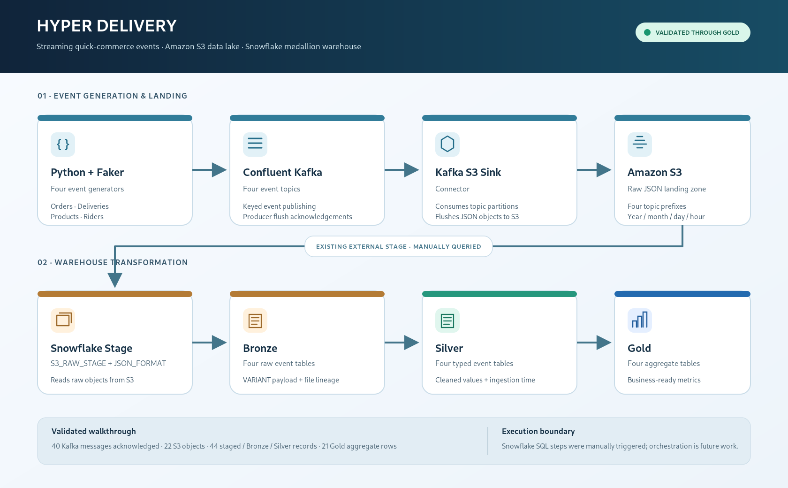

# Hyper Delivery — Streaming Data Engineering Project

A portfolio project that simulates a quick-commerce delivery platform and moves order, delivery, product, and rider events through a streaming data pipeline into an analytics-ready warehouse.

The validated implementation in this project walkthrough uses **Python, Faker, Confluent Kafka, Amazon S3, and Snowflake**. Power BI was intentionally left out of the validated scope; the current pipeline ends at the Snowflake Gold layer.



## Project overview

The Python application generates four related event types:

- **Orders** — customer/store order details, status, value, item count, and event timestamps.
- **Deliveries** — delivery, order, rider, expected/actual duration, and delivery status.
- **Products** — product, category, order/store references, quantity, and price.
- **Riders** — rider, city, availability status, current-order count, and event timestamp.

The events are published to four Kafka topics. A Kafka-to-S3 sink writes JSON objects to topic-specific prefixes in an S3 bucket. Snowflake reads those objects through an external stage, lands raw event payloads and file lineage in Bronze, converts them into typed Silver tables, and produces business aggregates in Gold.

## Architecture

See [the architecture notes](docs/ARCHITECTURE.md) and the [standalone SVG diagram](docs/architecture.svg).

```text
Python + Faker
      │
      ▼
Confluent Kafka — 4 event topics
      │
      ▼
Kafka S3 Sink Connector
      │
      ▼
Amazon S3 — raw JSON, partitioned by year/month/day/hour
      │
      ▼
Snowflake external stage + JSON file format
      │
      ▼
Bronze — raw VARIANT payload + file lineage
      │
      ▼
Silver — typed, cleaned event tables
      │
      ▼
Gold — status, popularity, rider and business aggregates
```

**Execution model:** the Python-to-Kafka publishing test and the Kafka-to-S3 delivery were verified. Snowflake stage inspection, Bronze loading, Silver processing, and Gold table creation were manually run from Snowflake worksheets during the walkthrough. This repository should not be described as having a fully automated scheduler/orchestrator unless one is added separately.

## Technology stack

| Area | Technology | Role |
|---|---|---|
| Event generation | Python, Faker | Create realistic sample quick-commerce events |
| Streaming | Confluent Kafka, `confluent-kafka` | Publish events to four topics |
| Configuration | `python-dotenv` | Load Kafka credentials and topic names from `.env` |
| Object storage | Amazon S3 | Store raw JSON event files |
| Warehouse | Snowflake | Load, transform, and aggregate events |
| SQL modelling | Snowflake SQL | Bronze, Silver, and Gold layers |

The walkthrough used Python 3.14 on Windows. The dependencies recorded in the supplied project assets are `confluent-kafka`, `python-dotenv`, and `faker`.

## Repository layout

The active project layout observed during implementation is:

```text
hyper-delivery-data-engineering/
├── 1_data_generation/
│   ├── config/
│   │   └── kafka_config.py
│   ├── generators/
│   │   ├── order_event.py
│   │   ├── delivery_event.py
│   │   ├── product_event.py
│   │   └── rider_event.py
│   ├── producers/
│   │   └── kafka_producer.py
│   ├── .env                 # local secrets; do not commit
│   └── main.py              # batch producer entry point
├── 2_snowflake/
│   ├── 01_setup/
│   ├── 02_bronze/
│   ├── 03_silver/
│   ├── 04_gold/
│   └── tests/
├── 3_power_bi/              # optional / not part of validated scope
├── 4_infrastructure/        # infrastructure notes/configuration, if used
├── requirements.txt
├── .gitignore
└── hyper_delivery_dashboard.pbix  # legacy/unvalidated in this walkthrough
```

The exact filenames inside `2_snowflake/01_setup` and `02_bronze` should be taken from the checked-in project files. The walkthrough specifically used `setup_hyper_delivery_silver_layer.sql` and `setup_hyper_delivery_gold_layer.sql` in their matching folders.

## Configuration and secrets

The Python Kafka configuration reads these variables from `1_data_generation/.env`:

```dotenv
BOOTSTRAP_SERVERS=your-kafka-bootstrap-server
KAFKA_API_KEY=your-kafka-api-key
KAFKA_API_SECRET=your-kafka-api-secret
ORDER_TOPIC=your-order-topic
DELIVERY_TOPIC=your-delivery-topic
PRODUCT_TOPIC=your-product-topic
RIDER_TOPIC=your-rider-topic
```

Use the exact bootstrap server, credentials, and topic names from your Kafka provider. Do not copy credentials into source code, README files, screenshots, or commits. The `.env` file is intentionally not included in this documentation pack. If a credential or private key was ever committed or shared, rotate it at the provider and replace the local value.

The active Snowflake objects observed in the walkthrough are:

| Object | Name |
|---|---|
| Database | `HYPER_DELIVERY_DB` |
| Schemas | `BRONZE`, `SILVER`, `GOLD` |
| Storage integration | `HYPER_DELIVERY_S3_INT` |
| External stage | `HYPER_DELIVERY_DB.BRONZE.S3_RAW_STAGE` |
| JSON file format | `HYPER_DELIVERY_DB.BRONZE.JSON_FORMAT` |
| S3 bucket | `hyper-delivery-data-20261012-k7m4` |
| S3 root prefix | `raw/` |

The stage points at the existing S3 bucket. Do not recreate the integration, stage, bucket, or tables when following this guide in the already-configured environment.

## Run the Python event generator

Run commands from the repository root in PowerShell.

### 1. Create and activate a virtual environment (new machine only)

```powershell
python -m venv .venv
.\.venv\Scripts\Activate.ps1
```

If PowerShell blocks activation, use the Python interpreter already configured in your IDE or follow your machine's local execution policy. Do not change system policy solely for this project without understanding the impact.

### 2. Install dependencies

```powershell
python -m pip install --upgrade pip
python -m pip install -r .\1_data_generation\requirements.txt
```

If your active checkout keeps `requirements.txt` only at the repository root, use that file instead. The requirements list observed in the supplied assets is:

```text
confluent-kafka
python-dotenv
faker
```

### 3. Configure Kafka

Create `1_data_generation/.env` using the variable names shown above. Confirm that all four Kafka topics exist and that the topic values in `.env` match the topics configured in the Kafka S3 Sink Connector.

### 4. Publish a small test batch

```powershell
python .\1_data_generation\main.py --count 10
```

The batch entry point used during the walkthrough creates 10 orders and one related delivery, product, and rider event for each order. It then flushes the producer and reports delivery confirmations.

Expected result for a successful 10-order test:

- 10 order events
- 10 delivery events
- 10 product events
- 10 rider events
- 40 messages confirmed delivered by the Kafka producer

Start with a small count. Increase it only after confirming that the S3 sink is keeping up and Snowflake loads are behaving as expected.

## S3 landing zone

The configured S3 bucket observed during the walkthrough is:

```text
s3://hyper-delivery-data-20261012-k7m4/raw/
```

The four topic-specific prefixes observed are:

```text
raw/quick_commerce_order_events/
raw/quick_commerce_delivery_events/
raw/quick_commerce_product_events/
raw/quick_commerce_rider_events/
```

The sink wrote objects beneath date/hour partitions such as `year=2026/month=11/day=02/hour=20/`. Files are grouped by Kafka topic/partition and may be flushed in batches. **The number of S3 files is not the same as the number of event records.**

## Snowflake processing order

Use the existing SQL scripts and objects in this order:

1. **Setup** — confirm the existing storage integration, JSON file format, stage, database, and schemas. Do not rerun resource-creation statements blindly in an established environment.
2. **Bronze** — use the existing `COPY INTO` logic to load the four topic prefixes into the corresponding Bronze tables. Do not use `FORCE = TRUE` for routine incremental loads.
3. **Silver** — run the existing typed/cleaning transformations. For incremental processing, use the project's deduplication/business-key checks rather than blindly rerunning inserts.
4. **Gold** — run `setup_hyper_delivery_gold_layer.sql`. The observed Gold script uses `CREATE OR REPLACE TABLE` to rebuild the four aggregate tables from current Silver data.
5. **Tests** — run the count and data-quality queries in `2_snowflake/tests/` or the verification queries documented in [VALIDATION.md](docs/VALIDATION.md).

The SQL worksheet execution in the validated walkthrough was manual. Re-running the setup files is not the same as scheduling a pipeline. Review DDL and DML before execution, especially `CREATE OR REPLACE`, `TRUNCATE`, `DELETE`, `FORCE`, and `INSERT` statements.

## Validated results

The following results were observed during the walkthrough on **3 November 2026**:

| Check | Observed result | Interpretation |
|---|---:|---|
| Python batch size | 10 orders | One test batch |
| Kafka producer delivery | 40 / 40 messages | All four event types published |
| S3 objects visible through Snowflake `LIST` | 22 files | Six delivery, five order, five product, six rider objects |
| Records read directly from the staged JSON files | 44 | 11 records per event type, including one earlier record per type |
| Bronze table counts | 44 | 11 rows in each of four Bronze tables |
| Silver table counts | 44 | 11 rows in each of four Silver tables |
| Gold aggregate rows | 21 | 4 order-status, 5 product, 1 rider-status, 11 business-metric rows |

See [VALIDATION.md](docs/VALIDATION.md) for the recorded checks and caveats.

## Known scope and limitations

- The validated pipeline ends at Snowflake Gold. Power BI was skipped and the `.pbix` file was not validated as part of this final AWS/Snowflake run.
- Snowflake stage listing, Bronze `COPY`, Silver processing, and Gold refresh were manually initiated during the walkthrough.
- No orchestration/scheduler, alerting, retry workflow, schema registry, CI pipeline, or production monitoring has been demonstrated.
- The test evidence is a small functional batch, not a throughput, resilience, or production-scale performance test.
- The older asset archive contains Databricks/Azure and Synapse materials from an earlier project direction. Those are legacy artifacts and are not part of the validated AWS + Snowflake path documented here.

## Suggested next improvements

1. Add an orchestrator (for example, a scheduled Snowflake Task or an external workflow tool) for incremental Bronze/Silver/Gold processing.
2. Add data-quality checks for unique IDs, null required fields, valid status values, and referential consistency between order/delivery/product/rider events.
3. Add a repeatable test dataset and automated tests for the event generators and SQL transformations.
4. Add operational monitoring for Kafka connector status, S3 object freshness, Snowflake load history, and failed records.
5. Add a dashboard only after the Gold model and refresh process are stable.

## Portfolio summary

> Built a streaming quick-commerce data pipeline that generates related order, delivery, product, and rider events with Python/Faker; publishes 40 test messages through Confluent Kafka; lands partitioned JSON files in Amazon S3; and processes the data through Snowflake Bronze, Silver, and Gold layers. Validated 44 staged/Bronze/Silver records and 21 analytical Gold rows across four aggregate tables.
