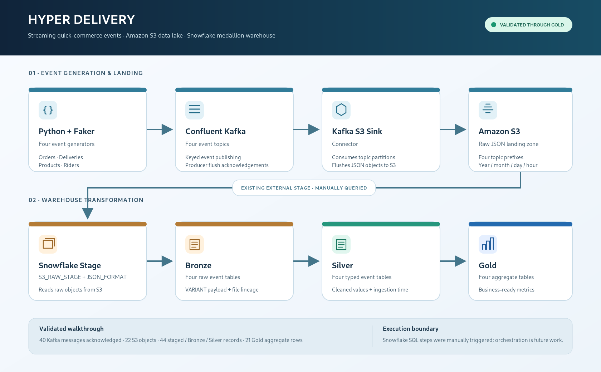
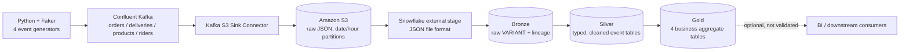

# Architecture and data flow

## Overview

The active implementation demonstrated in the project walkthrough is a streaming ingestion and warehouse-modelling pipeline:

1. Python generates four related quick-commerce event types.
2. The Confluent Kafka producer publishes each event to its matching topic.
3. A Kafka S3 Sink Connector writes JSON records to topic-specific S3 prefixes.
4. Snowflake exposes the raw files through an external stage and JSON file format.
5. Bronze stores the raw `VARIANT` payload and source-file lineage metadata.
6. Silver extracts typed business columns and adds ingestion timestamps.
7. Gold rebuilds business-facing aggregate tables from Silver.



## Event domains

| Domain | Business key | Important relationships |
|---|---|---|
| Order | `order_id` | Parent transaction for delivery and product events |
| Delivery | `delivery_id` | References `order_id` and `rider_id` |
| Product | `product_id` | References `order_id` and store |
| Rider | `rider_id` | Referenced by delivery events |

The generator update used in the walkthrough passes the generated order ID, store ID, and city into the product event, and the order ID, rider ID, store ID, and city into the delivery event. This makes the sample entities related rather than four completely independent streams.

## Storage layout

```text
s3://hyper-delivery-data-20261012-k7m4/
└── raw/
    ├── quick_commerce_order_events/
    ├── quick_commerce_delivery_events/
    ├── quick_commerce_product_events/
    └── quick_commerce_rider_events/
        └── year=YYYY/month=MM/day=DD/hour=HH/
            └── topic-partition-offset.json
```

Each topic has its own prefix. The sink writes partitioned objects; one object can hold multiple event records, so object count and record count should be checked separately.

## Snowflake layers

### Bronze

Database: `HYPER_DELIVERY_DB`, schema: `BRONZE`.

Tables:

- `BRONZE_ORDER_EVENTS`
- `BRONZE_DELIVERY_EVENTS`
- `BRONZE_PRODUCT_EVENTS`
- `BRONZE_RIDER_EVENTS`

The observed Bronze design includes an `EVENT VARIANT` column and metadata fields for source file, file row number, content key, file last-modified time, scan time, and ingestion/load lineage.

### Silver

Database: `HYPER_DELIVERY_DB`, schema: `SILVER`.

Tables:

- `SILVER_ORDER_EVENTS`
- `SILVER_DELIVERY_EVENTS`
- `SILVER_PRODUCT_EVENTS`
- `SILVER_RIDER_EVENTS`

Silver extracts event properties into typed columns, performs basic type conversion/cleaning, and records an ingestion timestamp. The walkthrough used an incremental insert/deduplication approach to add unseen business keys while preserving the first existing Silver records.

### Gold

Database: `HYPER_DELIVERY_DB`, schema: `GOLD`.

Tables:

- `GOLD_ORDERS_STATUS` — latest order state grouped by order status.
- `GOLD_PRODUCT_POPULARITY` — product popularity/aggregate order counts.
- `GOLD_RIDER_STATUS` — latest rider status distribution.
- `GOLD_BUSINESS_METRICS` — delivery/business metrics grouped by city and time window.

The Gold SQL file observed in the walkthrough uses `CREATE OR REPLACE TABLE ... AS` statements. This is a rebuild of each Gold aggregate from Silver, not an incremental append. Review the SQL before re-running it if downstream consumers are connected.

## Execution boundaries

- **Streaming boundary:** Python → Kafka → S3. Kafka producer delivery was confirmed by the producer flush result. S3 objects were then visible in the existing bucket and through Snowflake's stage.
- **Warehouse boundary:** Snowflake stage → Bronze → Silver → Gold. These steps were manually run in worksheets during validation; automatic orchestration was not demonstrated.
- **Presentation boundary:** Power BI was excluded from the validated run. The delivered pipeline ends at Gold.

## Reliability and design considerations

- Keep Kafka credentials in `.env` or a secrets manager, never in source control.
- Use Kafka message keys consistently to support partition-level ordering for a given entity.
- Preserve source filename and row metadata in Bronze for traceability and replay analysis.
- Avoid `FORCE = TRUE` for routine Snowflake file loads; it can reload files that Snowflake has already tracked.
- Make Silver transformations idempotent using business keys and deterministic deduplication.
- Gold rebuilds are suitable for this small demo; for larger datasets, consider incremental models and scheduled orchestration.
- Add dead-letter handling, connector monitoring, schema evolution strategy, and automated data-quality tests before production use.

## Mermaid source


